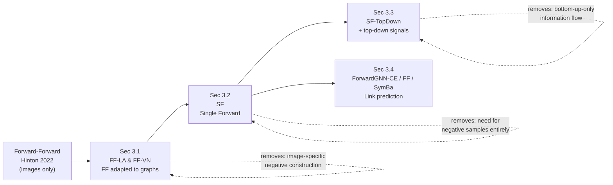
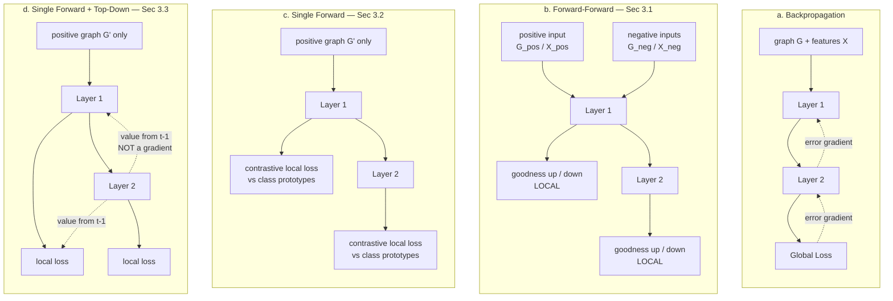
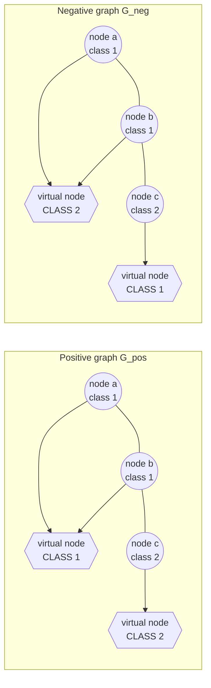
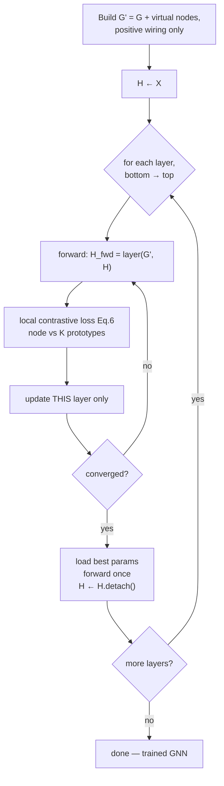
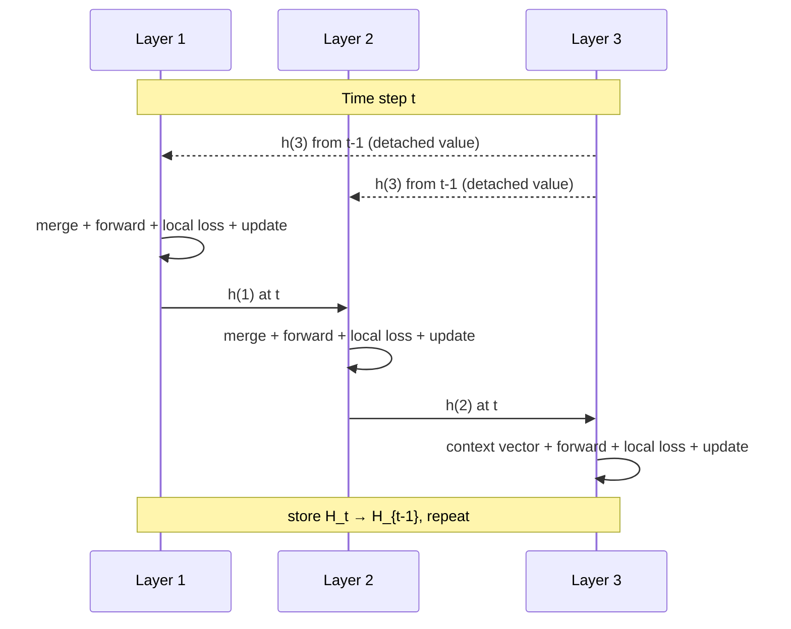

# ForwardGNN: Forward Learning of Graph Neural Networks — Structured Explainer

**Source paper:** Park, Wang, Simoulin, Yang, Yang, Rossi, Trivedi, Ahmed. *Forward Learning of Graph Neural Networks.* ICLR 2024. (arXiv:2403.11004v2)
**Code:** https://github.com/facebookresearch/forwardgnn

**How to read this document**
- **Part 1** — high-level, conceptual: what each algorithm is and why it exists.
- **Part 2** — the formal mathematics, equation by equation.
- **Part 3** — the same mathematics restated in plain English, with concrete analogies.
- **Part 4** — diagrams (Mermaid), results, and a critical appraisal you can use as a starting point for your own evaluation of the paper.

---

## Part 0 — The Problem the Paper Is Attacking

Backpropagation (BP) trains a network in two passes: a forward pass that computes and **stores** activations, and a backward pass that pushes error gradients back down through every layer. The authors identify three constraints this imposes:

| Constraint | Consequence |
|---|---|
| Activations from the forward pass must be stored for the backward pass | Memory grows with depth |
| A layer's update depends on signals from *all* downstream layers | Non-local learning; no layer can be trained in isolation |
| Updates happen only after the full forward pass, in reverse order | Limits parallelism and pipelining |

These are also the reasons BP is considered biologically implausible — real synapses update from locally available signals.

The paper's target: train GNNs **without any backward pass**, for the two fundamental graph learning tasks — **node classification** and **link prediction** — which prior forward-learning work had never addressed.

---

# Part 1 — High-Level Description of the Proposed Algorithms

ForwardGNN is not a single algorithm but a **family of four** (plus a link-prediction variant), arranged as a progression where each step removes a weakness of the previous one.

### 1.1 Background — the Forward-Forward algorithm (FF)

FF replaces BP's forward+backward passes with **two forward passes**: one over *positive* (real) data, one over *negative* (corrupted) data. Each layer has its own **local objective**: maximise a scalar called **goodness** on positives, minimise it on negatives. Layers are trained **greedily, bottom to top** — once a layer is trained it is frozen. In images, positives are made by overlaying the correct one-hot label on the image; negatives use a wrong label.

Two things break when you move this to graphs: (i) the negative-construction recipe is image-specific, and (ii) generating *K−1* negatives per node multiplies memory and compute.

---

### 1.2 Algorithm A — **FF-LA** (Forward-Forward with Label Appending) — Sec. 3.1

**Idea:** carry the label in the *node features*. Concatenate a label-derived vector onto each node's feature vector. Correct label → positive sample. Random wrong label → negative sample. The graph structure is untouched.

**Novel wrinkle vs. images:** in a graph, not every node has a label (test nodes are held out; graphs may be partially labelled). For unlabelled nodes the authors append a **uniform distribution** over classes instead of a one-hot — every class contributes equally, so the node carries no label information either way.

---

### 1.3 Algorithm B — **FF-VN** (Forward-Forward with Virtual Nodes) — Sec. 3.1

**Idea:** carry the label in the *graph structure* instead. Add *K* **virtual nodes**, one per class. Wire each labelled real node to the virtual node of its true class → positive graph. Wire it to a randomly chosen wrong virtual node → negative graph. Node features are untouched.

**Why this is elegant:** because message passing runs over the augmented graph, a virtual node aggregates from exactly the real nodes of its class, so it *becomes a learned class prototype for free* — no extra architecture needed. This side effect is what the next algorithm exploits.

FF-LA and FF-VN are described as **orthogonal**: one perturbs features, the other perturbs structure. Both are still forward-*forward* (two passes) and still need negatives.

---

### 1.4 Algorithm C — **SF** (Single Forward) — Sec. 3.2 ★ *the paper's central contribution*

**Idea:** stop constructing negatives at the *input* level. Run **one** forward pass on the **positively augmented graph only**. That single pass simultaneously produces (a) embeddings of real nodes and (b) embeddings of virtual nodes = class representatives. Then train each layer with a **local contrastive loss** that pulls each node toward its own class representative and pushes it away from the other *K−1* representatives.

The negatives now live **inside the loss function**, not in the input data. Consequences:
- One forward pass instead of two (and instead of *K−1* negative passes).
- Memory is roughly flat in the number of layers.
- No task-specific recipe for generating negative inputs.
- The method is **no longer "forward-forward"** — hence the rename to *ForwardGNN*.

---

### 1.5 Algorithm D — **SF-TopDown** (Single Forward with Top-Down Signals) — Sec. 3.3

**The problem it fixes:** greedy bottom-to-top training means layer ℓ only ever sees information from layers 1…ℓ−1. It never learns anything from what layers ℓ+1…L discovered. BP gets this for free through the backward pass.

**Idea:** unroll training **over time steps**. When training layer ℓ at time *t*, feed it the outputs that the *upper* layers produced at time *t−1*. Crucially this is a forward-directional data flow, not a gradient flow — **no gradients cross layer boundaries**, so it stays forward-only.

Two variants:

| Variant | Where the top-down signal is injected |
|---|---|
| **Top-to-Input** | Merged into the layer's *input* — so it changes what the layer computes |
| **Top-to-Loss** | Merged into the layer's *output* before the loss — so it changes only what the layer is scored against |

Empirically (Table 1 and the appendix tables) **Top-to-Input is the reliable one**; Top-to-Loss often degrades badly as depth increases.

---

### 1.6 Algorithm E — **ForwardGNN for Link Prediction** — Sec. 3.4

**Observation:** standard link-prediction training *already* looks like FF — you learn to separate existing edges (positive) from sampled non-edges (negative) by a score. So no graph augmentation and no virtual nodes are needed.

Each layer is trained **locally** to score edges, using node embeddings produced by that layer. Three objective variants are evaluated: **-CE** (binary cross entropy), **-FF** (goodness objective, Eq. 3), and **-SymBa**. At inference, link probability is the **average** over all layers. ForwardGNN-CE is reported as the best overall on accuracy *and* stability.

---

# Part 2 — Mathematical Definitions

### 2.0 Notation

| Symbol | Meaning |
|---|---|
| $G=(V,E)$ | graph, nodes $V$, edges $E$ |
| $\mathbf{x}_i \in \mathbb{R}^{F_1}$ | input features of node $i$ |
| $\mathbf{h}_i^{(\ell)} \in \mathbb{R}^{H}$ | embedding of node $i$ from layer $\ell$; $\mathbf{h}_i^{(0)} = \mathbf{x}_i$ |
| $\mathcal{N}(i)$ | neighbours of node $i$ |
| $e_{(j,i)}$ | optional edge features |
| $L$ | number of GNN layers |
| $K$ | number of node classes |
| $C=\{c_k\}_{k=1}^{K}$ | set of virtual nodes, one per class |
| $V_\text{labeled} \subseteq V$ | labelled nodes |
| $\tau$ | temperature |
| $\theta$ | goodness threshold |

---

### 2.1 The GNN message-passing backbone (Eq. 1)

$$
\mathbf{h}_i^{(\ell)} \;=\; \gamma^{(\ell)}\!\Bigl(\mathbf{h}_i^{(\ell-1)},\; \bigoplus_{j \in \mathcal{N}(i)} \psi^{(\ell)}\bigl(\mathbf{h}_i^{(\ell-1)},\, \mathbf{h}_j^{(\ell-1)},\, e_{(j,i)}\bigr)\Bigr)
$$

- $\psi^{(\ell)}(\cdot)$ — **message function**: builds a message from a neighbour pair.
- $\bigoplus$ — **permutation-invariant aggregator** (mean, max, …).
- $\gamma^{(\ell)}(\cdot)$ — **update function**: combines the node's own embedding with the aggregate.

GCN, GraphSAGE and GAT are all instances, differing only in the choice of these three functions. ForwardGNN is **agnostic** to this choice.

---

### 2.2 Goodness and the FF objective (Eqs. 2–3)

Goodness of object $i$ at layer $\ell$, where $\mathbf{a}_i^{(\ell)}$ is the ReLU activation:

$$
G_i^{(\ell)} \;=\; \bigl\lVert \mathbf{a}_i^{(\ell)} \bigr\rVert_2^2
$$

Probability that layer $\ell$ judges $i$ positive:

$$
p(\text{positive}) \;=\; \sigma\!\bigl(G_i^{(\ell)} - \theta\bigr), \qquad \sigma(a)=\frac{1}{1+e^{-a}}
$$

**Normalisation constraint.** Because goodness *is* the squared $L_2$ length, the next layer could cheat by simply reading off the input vector's length. FF therefore **$L_2$-normalises the activation before passing it up**, forcing the next layer to use the *orientation* of the vector, not its magnitude.

---

### 2.3 FF-LA — extending node features with labels (Eq. 4)

$$
\mathbf{x}_i' \;=\; \bigl[\, \mathbf{x}_i \;\Vert\; \textit{Label-To-Feat}(i) \,\bigr]
$$

where $[\cdot\Vert\cdot]$ is concatenation and

$$
\textit{Label-To-Feat}(i) =
\begin{cases}
\text{one-hot}(y_i) & \text{positive, } i \in V_\text{labeled}\\[2pt]
\text{one-hot}(\tilde y_i),\ \tilde y_i \ne y_i & \text{negative, } i \in V_\text{labeled}\\[2pt]
\bigl(\tfrac{1}{K},\dots,\tfrac{1}{K}\bigr) & i \notin V_\text{labeled}
\end{cases}
$$

Positive and negative embeddings come from running Eq. (1) on the **same graph $G$** with different initial features $\mathbf{x}_i^{\text{pos}'}$ and $\{\mathbf{x}_i^{\text{neg},j'}\}_j$ as $\mathbf{h}_i^{(0)}$.

---

### 2.4 FF-VN — extending graph structure with virtual nodes (Eq. 5)

$$
G' \;=\; \bigl(V \cup C,\;\; E \cup \{\,(i,c) \mid i \in V_\text{labeled},\ c \in C,\ \textit{Label-RE}(i) = \textit{Label-VR}(c)\,\}\bigr)
$$

- $\textit{Label-VR}(c)$ — **always** returns the true class of virtual node $c$.
- $\textit{Label-RE}(i)$ — returns the **correct** label for the positive graph $G^{\text{pos}'}$, a **randomly chosen incorrect** label for a negative graph $G^{\text{neg},j'}$.

Embeddings come from running Eq. (1) on $G^{\text{pos}'}$ and $\{G^{\text{neg},j'}\}_j$ with the **same** features $\mathbf{x}_i = \mathbf{h}_i^{(0)}$.

**Inference for FF-LA / FF-VN.** For node $v$ and each candidate label $l \in \{1..K\}$, build the corresponding extended input, run the GNN, and accumulate goodness across all layers. Predict

$$
\hat y_v \;=\; \arg\max_{l}\ \sum_{\ell=1}^{L} G_{v,l}^{(\ell)}
$$

---

### 2.5 SF — single-forward local contrastive objective (Eq. 6)

Run **one** forward pass on $G^{\text{pos}'}$. Layer $\ell$ produces real-node embeddings $\mathbf{h}_i^{(\ell)}$ and class-representative embeddings $\mathbf{c}_k^{(\ell)}$ (the virtual nodes). The local loss for layer $\ell$:

$$
\mathcal{L}^{(\ell)} \;=\; \frac{1}{|V_\text{labeled}|}\sum_{i \in V_\text{labeled}} L\bigl(\mathbf{h}_i^{(\ell)}, i, \ell\bigr)
$$

$$
L(\mathbf{h}, i, \ell) \;=\; -\log \frac{\exp\bigl(\mathcal{C}(\mathbf{h},\, \mathbf{c}^{(\ell)}_{\textit{Label}(i)})/\tau\bigr)}{\sum_{k \in [\![1,K]\!]} \exp\bigl(\mathcal{C}(\mathbf{h},\, \mathbf{c}^{(\ell)}_{k})/\tau\bigr)}
$$

- $\mathcal{C}(\cdot,\cdot)$ — critic / similarity function (e.g. dot product).
- $\textit{Label}(i)$ — maps node $i$ to its class index.
- $\tau$ — temperature (set to 1.0 in experiments).

This is an **InfoNCE-style / softmax-over-prototypes** objective. The "negatives" are the $K-1$ non-matching class representatives, which already exist in the same forward pass.

**Inference for SF.** The softmax inside the logarithm *is* a class distribution. Average it across layers and take the argmax:

$$
\hat y_v \;=\; \arg\max_{k}\ \frac{1}{L}\sum_{\ell=1}^{L} \frac{\exp\bigl(\mathcal{C}(\mathbf{h}_v^{(\ell)}, \mathbf{c}_k^{(\ell)})/\tau\bigr)}{\sum_{k'} \exp\bigl(\mathcal{C}(\mathbf{h}_v^{(\ell)}, \mathbf{c}_{k'}^{(\ell)})/\tau\bigr)}
$$

---

### 2.6 Top-down signal paths (Eqs. 7–8)

Introduce a time index $t$. Let $\mathbf{h}^{(\ell)}_{i,t}$ be node $i$'s embedding from layer $\ell$ at time $t$.

**Top-to-Input (Eq. 7).** Replace the input to layer $\ell$ with

$$
\mathbf{h}^{(\ell-1)'}_{i,t} \;=\; \textit{Merge}\bigl(\mathbf{h}^{(\ell-1)}_{i,t},\ \{\mathbf{h}^{(\ell+1)}_{i,t-1}, \dots, \mathbf{h}^{(L)}_{i,t-1}\}\bigr)
$$

**Top-to-Loss (Eq. 8).** Keep the input unchanged but score an augmented output:

$$
\mathcal{L}^{(\ell)'}_{t} \;=\; \frac{1}{|V_\text{labeled}|}\sum_{i \in V_\text{labeled}} L\bigl(\mathbf{h}^{(\ell)''}_{i,t},\, i,\, \ell\bigr),
\qquad
\mathbf{h}^{(\ell)''}_{i,t} = \textit{Merge}\bigl(\mathbf{h}^{(\ell)}_{i,t},\, \{\mathbf{h}^{(n)}_{i,t-1}\}_{n=\ell+1}^{L}\bigr)
$$

**Implementation choices reported in Appendix B:**
- For Eq. (7), $\textit{Merge}$ takes only the **immediate** upper layer $\mathbf{h}^{(\ell+1)}_{i,t-1}$ and **concatenates** it with the input.
- For Eq. (8), $\textit{Merge}$ takes signals from **all** upper layers, affecting the loss only.
- The topmost hidden layer has no layer above it, so its top-down signal is a **context vector**: one-hot of the label for training nodes, uniform vector otherwise (following Hinton, 2022).
- Updates may be **synchronous** (all layers at once) or **asynchronous/alternating** (even-indexed layers, then odd-indexed layers).

**Critical property:** the merged tensors are *detached* — no gradient flows across layers. The procedure remains strictly forward-only.

---

### 2.7 Link prediction (Eq. 9)

$$
p_{i,j} \;=\; \textit{LinkProb}\bigl(\textit{EdgeEmb}(\mathbf{h}_i, \mathbf{h}_j)\bigr)
$$

In the experiments: $\textit{EdgeEmb}$ = element-wise product, $\textit{LinkProb}$ = sum followed by sigmoid (i.e. dot product → sigmoid). Each layer is trained locally with its own objective (BCE, FF-goodness, or SymBa) over sampled positive edges $E^{\text{pos}'}$ and negative edges $E^{\text{neg}'}$.

**Inference:** $\;p_{i,j} = \frac{1}{L}\sum_{\ell=1}^{L} p^{(\ell)}_{i,j}$.

---

### 2.8 The algorithms as pseudocode summaries

| Alg. | Section | Core loop |
|---|---|---|
| **1 — FF (LA or VN)** | 3.1 | Build $G^{\text{pos}'},G^{\text{neg}'}$ (or $X^{\text{pos}'},X^{\text{neg}'}$). For each layer bottom→top: until converged, forward pos and neg, compute FF loss, update. Then freeze, forward once, **detach**, pass up. |
| **2 — SF** | 3.2 | Build $G'$ (positive only). For each layer bottom→top: until converged, forward once, compute Eq. (6), update. Freeze, forward, **detach**, pass up. |
| **3 — SF-TopDown** | 3.3 | Outer loop over time $t$. Inner loop over **all** layers each step: optionally merge top-down into input (Eq. 7), forward + detach, compute Eq. (6) or Eq. (8), update. Then $H_{t-1} \leftarrow H_t$. |
| **4 — LP** | 3.4 | Sample $E^{\text{pos}'},E^{\text{neg}'}$. For each layer bottom→top: until converged, forward on original $G$, score edges via Eq. (9), local loss, update. Freeze, forward, **detach**, pass up. |

Note the structural difference: Algorithms 1, 2, 4 have the **layer loop outside** and the convergence loop inside (greedy, one layer finished before the next starts). Algorithm 3 inverts this — the **convergence loop is outside** and all layers are touched each time step, because top-down signals require upper layers to already be doing something.

---

# Part 3 — The Same Mathematics in Plain English

### 3.1 Message passing (Eq. 1) — "ask your neighbours, then update yourself"

Every node writes a short note about itself to each neighbour ($\psi$). Each node reads all the notes it received and boils them down to a single summary in a way that doesn't depend on reading order ($\bigoplus$). Then each node rewrites its own description by combining what it already knew with that summary ($\gamma$). Repeat once per layer. After $L$ layers, a node's description reflects everything within $L$ hops of it.

### 3.2 Goodness (Eqs. 2–3) — "how loudly did this layer react?"

Take the layer's output vector, square every entry, add them up. That single number is the **goodness** — essentially how energetically the layer responded. The layer's job is: *react loudly to real things, react quietly to fake things.* The threshold $\theta$ is the dividing line, and the sigmoid just turns "how far above/below the line" into a probability.

The normalisation rule closes a loophole: since goodness is just "how long is this vector", the next layer up could tell real from fake by measuring length alone without learning anything useful. So the vector is rescaled to unit length before being handed upward — the next layer must rely on *which direction* the vector points, which is where the actual information lives.

### 3.3 FF-LA (Eq. 4) — "staple a label onto each node's description"

Each node has a list of numbers describing it. Staple a few extra numbers on the end encoding "my class is #3". If you staple the true class, that's a **positive** example. Staple a wrong class, that's a **negative** example. The network learns to notice when the stapled-on label doesn't fit the rest of the description.

The unlabelled-node trick: for nodes whose class you don't know, staple on "it's equally likely to be any class" — a flat distribution. That way you're not lying about them and you're not accidentally teaching the network a fake label.

### 3.4 FF-VN (Eq. 5) — "invent one club per class and check who joins"

Create one extra fake node per class — think of it as a **club**. In the positive version of the graph, every labelled node joins its correct club. In a negative version, nodes join wrong clubs. Because message passing is running, each club node ends up receiving messages from all its members and thereby becomes a **summary of what that class looks like** — a prototype, obtained for free.

From a real node's point of view, the *only* difference between the positive and negative graph is which club it's wired into. So the layer must learn to notice "the club I'm attached to doesn't match my features" — which forces it to keep the features that correlate with class and downplay the ones that don't.

### 3.5 SF (Eq. 6) — "one pass, then pull toward your own prototype"

Here's the key realisation: you only need the *positive* graph. Run it once. Out come two kinds of things at every layer — descriptions of real nodes, and descriptions of the class clubs (prototypes).

Now for each labelled node, measure its similarity to **all $K$ prototypes**. Turn those $K$ similarity scores into probabilities with a softmax. The loss says: *make the probability of the correct prototype as high as possible.* Mathematically that automatically pushes the node away from the other $K-1$ prototypes, because softmax probabilities must sum to one.

So the contrast is still there — you're still contrasting right against wrong — but the wrong options are **the other prototypes you already computed**, not extra corrupted copies of the whole graph you had to build and push through the network. That's the entire efficiency argument in one sentence.

$\tau$ (temperature) is a sharpness dial: small $\tau$ makes the softmax very peaked (harsh — only the best match counts), large $\tau$ makes it soft (lenient).

**Predicting:** the softmax in the loss is already a class-probability distribution. Ask every layer for its opinion, average the distributions, pick the winner.

### 3.6 Top-down signals (Eqs. 7–8) — "let the upper floors send a memo downstairs"

Greedy layer-wise training has an organisational flaw: layer 1 is finalised before layer 3 has learned anything, so layer 1 never benefits from layer 3's insight. BP doesn't have this problem because the error report travels all the way back down.

The fix is to train **in rounds**. In round $t$, when layer 2 is being updated, it is handed a copy of what layer 3 produced in round $t-1$ — last round's memo from upstairs.

- **Top-to-Input:** the memo is glued onto layer 2's input, so it changes what layer 2 actually computes.
- **Top-to-Loss:** the memo is glued onto layer 2's output just before grading, so it only changes what layer 2 is graded on.

Why this isn't secretly backprop: a memo is a *value*, not a *gradient*. Nothing is differentiated through layer 3 to update layer 2. The tensors are detached. Information flows downward, but credit assignment stays local.

The topmost layer has nobody above it, so it's given the label itself as a context vector for training nodes (and a flat "no information" vector for everyone else).

### 3.7 Link prediction (Eq. 9) — "the task was already shaped like FF"

To predict whether an edge exists: take the two node descriptions, multiply them element-wise, sum the result, squash through a sigmoid → a probability. Train on real edges (should score high) and randomly sampled non-edges (should score low).

Notice that "separate real from fake using a score" is *exactly* the FF setup — so no virtual nodes, no augmented graph, no extra forward pass is needed. Every layer independently learns to do link prediction from its own embeddings, and at test time you average all the layers' predictions like a small committee.

---

# Part 4 — Diagrams, Results, and Critical Appraisal

## 4.1 Backpropagation vs. the four forward schemes

## 4.2 How FF-VN builds its two graphs

Real edges are unchanged between the two; only the real→virtual wiring flips. Appendix F.5 additionally studies **bidirectional vs unidirectional** real↔virtual edges and finds the answer is method-dependent: bidirectional helps FF and Top-to-Loss, unidirectional sometimes helps plain SF (notably on PubMed and GitHub), and it makes little difference for Top-to-Input.

## 4.3 SF training loop

The `.detach()` is the structural guarantee: it severs the computation graph so no gradient can ever reach a lower layer.

## 4.4 Top-down signalling over time

## 4.5 Reported results — what to actually take away

**Datasets** (Table 2): PubMed (19,717 nodes / 3 classes), CiteSeer (4,230 / 6), CoraML (2,995 / 7), Amazon-Photo (7,650 / 8), GitHub (37,700 / 2). Splits 64/16/20, five random splits, accuracy for node classification, ROC-AUC for link prediction. GNNs: GCN, GraphSAGE, GAT; hidden size 128; Adam, lr 0.001, wd 0.0005; max 1000 epochs, early stopping patience 100.

**SF vs BP — node classification.** Comparable in many cases, better in several, with **memory essentially flat in depth** while BP's memory grows up to ~18× at four layers.

**SF vs BP — link prediction.** SF mostly wins. The mechanism matters: BP-trained GNNs *degrade* as layers are added, while SF-trained ones improve or hold steady.

**Top-down signals help.** Averaged over GNNs and depths (Table 1):

| Method | CiteSeer | CoraML | PubMed | Amazon | GitHub |
|---|---|---|---|---|---|
| SF | 91.14 | 84.95 | 81.90 | 89.69 | 83.16 |
| SF-TopDown | **93.58** | **86.01** | **82.21** | **92.09** | **83.68** |

**Against other forward methods.** Best accuracy comes from either SF/SF-TopDown or the FF variants — but **FF variants are frequently unstable** and need far more memory (they build $K-1$ negative inputs per node). **CaFo** uses the least memory but underperforms badly because it freezes the GNN and trains only the attached predictors. **PEPITA** essentially fails to train GNNs for node classification.

**Training time** (Table 7). SF and the Sec. 3.1 methods can be **up to ~9× faster** than BP for GCN/SAGE, exploiting the fact that during a frozen-input greedy layer's training the neighbourhood aggregation is identical every epoch and can be computed **once**. This shortcut is unavailable for GAT (attention weights change the aggregation) and for top-down variants (the input changes each round) — there the training time can be *up to ~1.6× longer* than BP.

**Limited-label regime** (Appendix F.4, Planetoid splits). With 2 layers BP mostly beats SF; the contrastive mechanism appears to need more labelled data. The gap closes as depth increases. This is the most honest negative result in the paper and a good thread to pull on.

## 4.6 Strengths worth crediting

1. **Genuine gap identified and filled.** Prior FF work covered image classification and (via GFF) graph classification; node classification and link prediction were untouched. The claim of being first is well-supported by their related-work survey.
2. **The single-forward reframing is conceptually clean.** Moving the negatives from the input space to the loss space is the right abstraction, and it dissolves the task-specific negative-generation problem in one move.
3. **The virtual-node prototype trick is economical** — class representatives fall out of message passing rather than requiring a separate module.
4. **Evaluation breadth** — 3 GNNs × 5 graphs × 4 depths × ~9 learning methods × 5 splits, with full per-dataset tables, memory *and* time, plus a low-label regime and an ablation on edge directionality.
5. **Honest reporting** — the failure cases (Top-to-Loss collapsing at depth, GAT's slower SF training, the low-label deficit) are in the paper rather than buried.

## 4.7 Limitations and open questions — starting points for critique

1. **"Biologically plausible" is asserted more than argued.** The paper motivates itself heavily on biological plausibility but never evaluates it. Top-down signals in particular require *storing the previous time step's activations for every layer* — arguably reintroducing a memory-and-synchrony requirement that has its own plausibility cost. Worth pressing on.
2. **The memory comparison may flatter SF.** Greedy layer-wise training only ever holds one layer's optimiser state, so of course memory is flat in depth. The relevant question is memory at *equal accuracy*, and SF's absolute footprint is often higher than BP's at 1–2 layers (see Table 4: e.g. CiteSeer GCN, BP 0.52–4.01 MB vs SF 15.51 MB). The headline "18× increase" is a *relative-to-1-layer* figure, not an absolute advantage.
3. **Scale.** The largest graph is GitHub at 37.7k nodes / 578k edges. The scalability argument is the paper's central motivation, yet no OGB-scale or billion-edge experiment appears. The efficiency claims are extrapolated, not demonstrated at scale.
4. **Label leakage into the graph structure.** Virtual nodes are wired using training labels, and this augmented graph is used at inference. The authors handle unlabelled nodes carefully for FF-LA, but the interaction between structural label injection and transductive evaluation deserves scrutiny — especially with 64% of nodes labelled, which is a generous regime.
5. **The low-label result undercuts the practical case.** Real graph problems are usually label-poor. Appendix F.4 shows SF needs more labels than BP at shallow depth. This is the tension most worth examining.
6. **No depth beyond 4 layers.** Layer-wise/local training is often pitched as enabling very deep networks; the experiments stop at 4.
7. **Hyperparameters are largely inherited, not tuned.** $\tau = 1.0$, $\theta = 2.0$, $\alpha = 4.0$ are taken from prior papers. A sensitivity analysis on $\tau$ in Eq. (6) is absent and would matter for a contrastive objective.
8. **Instability of baselines.** Some standard deviations are extreme (e.g. FF-VN-GAT on Amazon at ±28.5; ForwardGNN-SymBa-GCN on GitHub at ±15.7). Averaging over unstable runs can make method rankings fragile.
9. **Top-to-Loss is presented as a variant but behaves like a failure mode** — on Amazon-GCN it falls from 93.76 (1 layer) to 47.40 (4 layers). A clearer diagnosis of why would strengthen the paper.

## 4.8 Questions to take into your own write-up

- Is "no backward pass" the same as "biologically plausible", and does the paper conflate the two?
- Does the greedy-freezing scheme impose a *representational* ceiling that top-down signals only partially lift — and could you design an experiment to isolate that?
- The contrastive loss is essentially prototype-based InfoNCE. How much of SF's gain is "forward learning" versus "a good contrastive objective that BP could also use"? The paper does not run **BP + Eq. 6** as a control, which is arguably the missing ablation.
- Can the class-prototype construction survive the extensions the authors sketch in Appendix D — graph classification (needs graph-level prototypes) and clustering (no labels at all, so no virtual-node wiring)?

---

## Appendix — Equation Index

| Eq. | Name | Belongs to |
|---|---|---|
| 1 | Message passing | GNN backbone |
| 2 | Goodness | FF / FF-LA / FF-VN |
| 3 | Positive probability via sigmoid + threshold | FF / FF-LA / FF-VN, and ForwardGNN-FF for LP |
| 4 | Label-appended features | FF-LA (Sec 3.1) |
| 5 | Virtual-node augmented graph | FF-VN (Sec 3.1), reused by SF |
| 6 | Local contrastive loss | SF (Sec 3.2) |
| 7 | Top-to-Input merge | SF-TopDown (Sec 3.3) |
| 8 | Top-to-Loss merge + loss | SF-TopDown (Sec 3.3) |
| 9 | Link probability | LP (Sec 3.4) |
